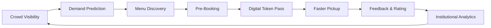

# 🚀 QueueLess: Smart Campus Cafeteria Intelligence Platform
> **Skip the Queue. Enjoy Your Food.**  
> *Know the crowd. Predict demand. Book your meal. Pick it up faster.*  
> Designed for **St. Peter's Engineering College (SPEC), Hyderabad**

---

## 📖 Product Overview

**QueueLess** is an end-to-end smart campus cafeteria intelligence and demand-forecasting platform. Rather than functioning as a generic food ordering app, QueueLess unites **Students**, **Cafeteria Staff**, **Campus Vendors**, and **College Administration** around a synchronized product loop:



---

## 👥 Role-Based Experience

### 1. 🎓 Student Experience
- **Real-Time Crowd Gauge & AI Forecast**: Live occupancy meter, queue depth estimates, and Recharts hourly forecast curves covering college break intervals (12:15 PM and 1:00 PM peaks).
- **Smart Menu Catalog**: Filter by dietary preference (Veg / Non-Veg), category (Meals & Biryani, South Indian, Quick Bites, Healthy Bowls, Beverages), live batch freshness tags ("Fresh Dum Batch Ready"), calories, and preparation time.
- **Pre-Booking & Pickup Scheduling**: Reserve meals for scheduled break periods (*Instant*, *12:15 PM Break*, *1:00 PM Break*, *4:15 PM Evening Break*).
- **Contactless Optical Digital Token**: Dynamic SVG QR code pass, status pipeline (*Order Placed* ➔ *In Kitchen* ➔ *Ready at Counter* ➔ *Collected*), audio arrival chimes, and counter routing.
- **Gamification & Rewards**:
  - XP progression, tier badges (*Queue Buster Elite*, *Punctual Picker*, *Zero-Waste Hero*).
  - Daily **Spin-to-Win** Cafeteria Wheel.
  - Daily **Campus Nutrition & Food Trivia** mini-game (+30 XP).
  - Campus Leaderboard tracking wait-time saved and zero-waste scores.
- **Dining Feedback**: 5-star ratings, quick tags (*2-min pickup*, *Hot & Fresh*, *Great Portion*), and instant +25 XP rewards.

### 2. 👨‍🍳 Cafeteria Staff (KDS & Counter POS)
- **Live Kitchen Display System (KDS)**: 4-column live kanban board (*Placed* ➔ *In Kitchen / Cooking* ➔ *Ready at Counter* ➔ *Collected*).
- **Token Verification Scanner**: Staff can verify student token IDs (`SPEC-702`) or scan barcodes to instantly mark orders fulfilled with auditory feedback.
- **Live Inventory & 86'd Stock Manager**: 1-click in-stock / sold-out toggle, batch quantity steppers, and freshness status customizer.
- **Crowd Control & Shift Controls**: Instant presets (*Light Traffic 25%*, *Mid-Shift 65%*, *Super Lunch Rush 95%*) and live campus announcement broadcast.

### 3. 🏛️ College Administration
- **Institutional Analytics Dashboard**:
  - Peak-hour wait time reduction metrics (**26 mins reduced to 4.2 mins, -84% improvement**).
  - Food wastage reduction tracking (**42.8 kg/day saved** through pre-order visibility).
  - Campus footfall tracking (3,640+ daily students across 4 outlets).
  - Vendor & counter performance matrix (Revenue, shift orders, on-time SLA compliance).
  - Menu category distribution donut charts.
  - Live student dining feedback sentiment stream (96% positive sentiment).
  - One-click CSV / Institutional report export.

---

## 🛠️ Technology Stack

- **Frontend**: React 18 with modern React Hooks & Functional Architecture
- **Tooling**: Vite 6+
- **Styling**: Tailwind CSS with custom glassmorphism design system & animations
- **Charts & Visualization**: Recharts (Responsive Area, Bar, Line & Donut charts)
- **Icons**: Lucide React
- **Celebration Effects**: Canvas Confetti & Web Audio API synthesis
- **State Management**: React Context API with persistent localStorage caching

---

## 🚀 Running the Project Locally

```bash
# Clone and enter directory
cd queueless

# Install dependencies
npm install

# Start development server
npm run dev

# Build for production
npm run build
```

---

## 🏛️ Designed For
**St. Peter's Engineering College (SPEC)**  
Opp. Forest Academy, Maisammaguda, Medchal-Malkajgiri, Hyderabad, Telangana  
*Multi-Campus & Multi-Vendor Architecture Ready*
